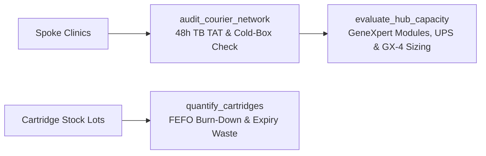

# labhub-opt

[](https://github.com/codesphere-u/labhub-opt/actions/workflows/ci.yml)
[](LICENSE)
[](pyproject.toml)
[](pyproject.toml)

**Zero-dependency TB & HIV diagnostic hub planner: GeneXpert 4/16-module throughput & utilization, FEFO cartridge & reagent quantification, hub-and-spoke sputum courier turnaround SLA, and specimen cold-box viability.**

- **Mission Domain:** Healthcare & Diagnostic Laboratory Networks (TB / HIV)
- **Stack:** Pure Python 3.11+ (zero runtime third-party dependencies, `mypy --strict`, `ruff`, `pytest`)
- **Maintainer:** Codesphere Innovations (U) Limited (`codesphere-u`)

---

## Problem Solved

District GeneXpert hubs routinely suffer 2-week TB result delays, aborted cartridges from unprotected grid dips, and simultaneous stockouts alongside expired cartridge boxes.

## Key Features

- GeneXpert instrument capacity & turnaround analyzer (`evaluate_hub_capacity`) across `xpert_mtb_rif_ultra`, `xpert_mtb_xdr`, `xpert_hiv_vl`, and `xpert_eid` with repeat-error overhead, UPS power-loss warnings, and GX-4 expansion counts.
- FEFO cartridge burn-down quantifier (`quantify_cartridges`) separating truly consumable stock from batches that will expire before demand can burn them.
- Hub-and-spoke motorcycle courier SLA auditor (`audit_courier_network`) verifying WHO 48-hour TB turnaround and 72-hour ambient sputum viability limits.

## Architecture Overview



See [docs/architecture.md](docs/architecture.md) for module-level design details.

## Installation

```bash
git clone https://github.com/codesphere-u/labhub-opt.git
cd labhub-opt
uv sync --extra dev
```

Or install in editable mode with standard `pip`:

```bash
pip install -e ".[dev]"
```

## Quick Start (CLI)

```bash
labhub-opt --hub HUB-LIRA-01 --modules 4 --tb-daily 14 --hiv-vl-daily 4
```

## Quick Start (Python API)

```python
from labhub_opt import LabHubSpec, evaluate_hub_capacity

rep = evaluate_hub_capacity(LabHubSpec('HUB-1', functional_modules=4, daily_sample_demand={'xpert_mtb_rif_ultra': 22.0}))
assert rep.overloaded and rep.additional_gx4_machines_needed >= 1
```

## Testing & Quality Gates

```bash
uv run ruff check src tests
uv run mypy src
uv run pytest -v
```

## Security, Contributing & Roadmap

- **Security:** See [SECURITY.md](SECURITY.md) for responsible disclosure procedures.
- **Contributing:** See [CONTRIBUTING.md](CONTRIBUTING.md) and [CODE_OF_CONDUCT.md](CODE_OF_CONDUCT.md).
- **Changelog & Roadmap:** See [CHANGELOG.md](CHANGELOG.md) and [ROADMAP.md](ROADMAP.md).

## License

MIT License — see [LICENSE](LICENSE).

## Support & Contact

Open an issue on [GitHub Issues](https://github.com/codesphere-u/labhub-opt/issues) or contact `codesphereinnovationz@gmail.com`.
